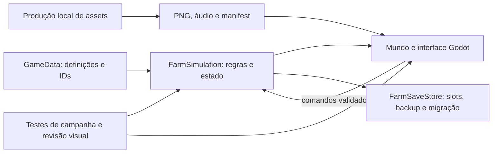

# Fazenda Entre Ecos — arquitetura e decisões

Fontes: GDD e Direção de Arte fornecidos pelo usuário, lidos integralmente (incluindo três diagramas). Os documentos são especificações de intenção, não evidência de duração, balanceamento ou funcionamento. Os números da V1 permanecem parâmetros iniciais.

## Estrutura

- `project.godot`, `scenes/`, `scripts/`, `data/`: jogo Godot 4.6.3 / GDScript, local e single player.
- `tools/north_asset_forge_2d/`: projeto local novo de produção, autorizado pelo usuário; não é uma cópia nem execução de uma ferramenta externa preexistente. Fontes editáveis, gerador e validação ficam aqui.
- `assets/`: somente exports integráveis, manifest e licença autoral.
- `tests/`: verificações do jogo e da campanha.
- `docs/`: contratos, decisões e resultados. `docs/source/` é uma cópia local dos documentos fornecidos; não integra a publicação do código nem a arte do jogo.

## Lacunas e resoluções

1. **Projeto vazio:** implementar o jogo no checkout existente. Não criar worktree, clonar projeto imaginário nem aplicar regras do setup que impediam criar código naquele onboarding.
2. **North ausente:** usuário pediu criação dentro do Git. Produção local nova separada em `tools/north_asset_forge_2d/`, com comandos reais documentados. Nenhuma reivindicação de uso de CLI/plugin indisponível.
3. **Métrica de movimento:** 96 pixels lógicos/s relativos à tela como interpretação de três tiles/s; diagonais normalizadas. Alcance da ação pela distância no grid lógico, máximo um tile. Física contínua; apresentação quantizada.
4. **Grade e mundo:** 48×48 tiles, projeção `(x-y)*32,(x+y)*16`; seis blocos 2×2. A/B/C/D = topo/direita/esquerda/baixo. Âncoras podem ajustar para legibilidade, preservando setores e acessos.
5. **Tempo:** simulação determinística compartilhada por active/offline, com ordem crescimento → padrão → coleta → venda → semeador → água. Painéis não passam tempo ao cultivo. Pesca e memória usam relógios próprios. Offline limitado a 1800 segundos reais × 0,25; não concede narrativa.
6. **Padrões:** PA1 só em B1/B2; PA2 B3/B4; PA3 B5 e B6 final. Sinal persiste depois da coleta. Bônus aplicado uma vez por planta/lote. P6 exige P5; lote final exige colheita e as sete pistas anteriores, depois válvulas I→II→III. O gate das pistas resolve a exigência de oito evidências obrigatórias: sem ele, P1 podia ser omitida. Erro reinicia só válvulas, e pistas faltantes não consomem o lote.
7. **Economia:** saldo em centavos inteiros; compras só usam moedas inteiras; sementes arredondadas por unidade para cima. Restos de rendimento separados por canteiro/cultura, inclusive depois de troca. Tetos únicos no módulo de economia.
8. **Reservas:** uma reserva global por cultura; não multiplicar por bloco. Piso de moedas de sementes = quatro sementes da configuração mais cara. Objetivo pode reservar requisitos de reparo ainda faltantes. Venda individual é escolha explícita; venda de excedente e automática protegem reservas.
9. **Recuperação:** nabo de emergência só no estado definido no GDD; madeira/pedra inesgotáveis, coleta em 2s/unidade, preço de venda 1, compra 6. Sem morte, perda por tempo nem bloqueio narrativo por upgrades.
10. **Persistência:** três slots; schema versionado, escrita temporária+substituição, backup anterior, corrupção sem novo jogo silencioso. Offline consumido e salvo antes de oferecer resumo novamente. Backup recuperado preserva o arquivo danificado; campos inválidos são rejeitados ou normalizados com aviso, posição obstruída vai para corredor seguro. Preferências independentes dos slots.
11. **Apresentação:** pixel art PNG com alpha; sem filtragem linear. UI independente, fontes legíveis com acentos. Ícones, texto e forma redundantes para estados. Sem tremor obrigatório; UI 100/125/150%, texto 100/125/150%.
12. **Ritmo:** preços e duração não são certificados. Validar percurso determinístico do início a P8 e registrar tempo de simulação separadamente de tempo humano. Ações alternativas existem durante crescimento; não inflar preços para alcançar 3–5h.

## Ordem e gates

1. Cultivo, economia, reserva, R1 e salvamento.
2. R2 + PA1 + P3, com coleta que preserva evidência. Revisar leitura de um bloco e interface antes do pacote completo.
3. Todas as culturas, reparos e árvores; máquinas, fabricação, P4–P8 e final.
4. Pesca, decoração, offline e acessibilidade.
5. Revisão integrada, captura visual real, export e teste do pacote executável.

Pendências e verificações efetivas serão mantidas em `docs/VALIDATION.md`. Revisão automática não substitui cinco jogadores novos nem prova a duração estimada.
